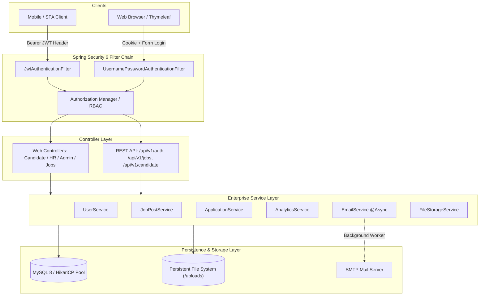

# 💼 CareerLink — Enterprise Full-Stack Job Portal & Recruitment Platform

[](https://www.oracle.com/java/)
[](https://spring.io/projects/spring-boot)
[](https://spring.io/projects/spring-security)
[](https://www.mysql.com/)
[](https://www.docker.com/)
[](http://localhost:8080/swagger-ui/index.html)
[](LICENSE)

> A production-grade, full-stack recruitment and talent acquisition platform built with modern **Java 21**, **Spring Boot 3**, **Spring Data JPA**, **Spring Security 6**, **Thymeleaf**, **Bootstrap 5**, **JJWT**, and **Docker**.

---

## 🌟 Key Architectural Features

- **🛡️ Hybrid Security Architecture**:
  - Stateful form authentication with session cookies (`JSESSIONID`) and CSRF protection for browser users.
  - Completely stateless **JSON Web Token (JWT)** authentication (`Authorization: Bearer <token>`) for mobile clients and Single Page Applications.
- **🔄 Finite State Machine (FSM)**:
  - Robust 5-stage application lifecycle: `APPLIED` ➔ `SHORTLISTED` ➔ `INTERVIEW_SCHEDULED` ➔ `ACCEPTED` / `REJECTED`.
- **⚡ Asynchronous Email Notifications (`@Async`)**:
  - Dedicated background worker thread pool (`EmailWorker-`) delivering rich HTML emails via Thymeleaf templates for submissions, interview invites, and status updates without blocking HTTP threads.
- **📊 Recruiter Hiring Funnel & Analytics**:
  - Visual conversion funnel tracking candidate progression rates.
  - Streaming CSV export engine compliant with RFC 4180 with spreadsheet formula injection protection.
- **📄 Secure Resume Storage & Inline PDF Streaming**:
  - Path traversal defense (`..` sanitization), unique UUID renaming, 5MB file validation, and inline HTTP streaming (`application/pdf`).
- **🔍 Multi-Parameter Dynamic Search & Pagination**:
  - Indexed filtering across keywords, locations, job categories, and employment types with Spring Data `Pageable`.
- **📖 Live OpenAPI 3 & Swagger Documentation**:
  - Self-documenting interactive REST API playground at `/swagger-ui/index.html` with Bearer token authorization.
- **🐳 Multi-Stage Docker Containerization**:
  - Hardened Alpine JRE 21 runtime running under an unprivileged `careerlink` non-root user, orchestrated with MySQL 8 via Docker Compose.

---

## 🏛️ System Architecture



---

## 👥 Role-Based Portals

| Role | Access URL | Key Capabilities |
| :--- | :--- | :--- |
| **Candidate** | `/candidate/dashboard` | Browse jobs, apply with resume & cover note, track application status, view interview invitations, update profile. |
| **HR / Recruiter** | `/hr/dashboard` | Post vacancies, manage applicants, transition candidate states, schedule interviews with Meet links, view analytics funnel, export CSVs. |
| **Admin** | `/admin/dashboard` | Verify and approve new HR recruiter accounts, monitor system health, oversee user accounts and listings. |
| **Public** | `/`, `/jobs` | Search and filter approved vacancies with pagination, explore categories, sign up as Candidate or Recruiter. |

---

## ⚡ Quickstart Guide

### Option 1: Run Locally with In-Memory H2 (Quick Dev)
Prerequisites: JDK 21+

```powershell
# 1. Clone repository and navigate to demo folder
cd demo

# 2. Run with Maven Wrapper (defaults to 'dev' profile with in-memory H2)
.\mvnw.cmd spring-boot:run
```
- Web Application: `http://localhost:8080`
- H2 Web Console: `http://localhost:8080/h2-console` (JDBC URL: `jdbc:h2:mem:careerlinkdb`, User: `sa`, Password: *blank*)
- Swagger UI Documentation: `http://localhost:8080/swagger-ui/index.html`

---

### Option 2: Run with Docker Compose (Production MySQL 8)
Prerequisites: Docker & Docker Compose

```powershell
# From project root
docker compose up --build -d
```
Docker Compose will:
1. Launch **MySQL 8.0** with persistent named volume `careerlink_mysql_data`.
2. Wait for MySQL to pass health check (`mysqladmin ping`).
3. Build the minimal, hardened multi-stage container (`careerlink-app`).
4. Apply the `prod` profile with HikariCP connection pooling and mount `/app/uploads`.

To stop services:
```powershell
docker compose down
```

---

## 🔑 Demo Seed Accounts

The application automatically seeds the database with initial demo accounts:

| Role | Email | Password | Details |
| :--- | :--- | :--- | :--- |
| **Candidate** | `candidate@test.com` | `candidate123` | Pre-applied for Senior Java Developer with interview scheduled. |
| **HR Recruiter** | `recruiter@techcorp.com` | `hr123` | Approved recruiter for *TechCorp Innovations* with 8 job postings. |
| **Administrator** | `admin@careerlink.com` | `admin123` | System admin with verification authority. |

---

## 📡 REST API Reference

| Method | Endpoint | Access | Description |
| :--- | :--- | :--- | :--- |
| `POST` | `/api/v1/auth/login` | Public | Authenticates credentials, returns signed JWT Bearer token |
| `POST` | `/api/v1/auth/register` | Public | Registers a new Candidate or Recruiter |
| `GET` | `/api/v1/jobs` | Public | Paginated, filtered job search (`keyword`, `location`, `categoryId`, `jobType`, `page`, `size`) |
| `GET` | `/api/v1/jobs/{id}` | Public | Retrieves specific job opening |
| `GET` | `/api/v1/jobs/categories` | Public | Lists all categories |
| `POST` | `/api/v1/jobs` | `ROLE_HR` | Creates a new job opening (requires Bearer token) |
| `GET` | `/api/v1/candidate/profile` | `ROLE_CANDIDATE` | Retrieves candidate profile details |
| `GET` | `/api/v1/candidate/applications` | `ROLE_CANDIDATE` | Lists candidate applications |
| `POST` | `/api/v1/candidate/apply` | `ROLE_CANDIDATE` | Submits application to a job opening |

---

## 🔒 Security Hardening

- **Password Hashing**: BCrypt with default salt generation (work factor 10).
- **SQL Injection Defense**: 100% parameterized queries via Spring Data JPA and Hibernate ORM.
- **Cross-Site Scripting (XSS)**: Automatic context-aware HTML entity escaping in Thymeleaf templates (`th:text`).
- **CSRF Protection**: Synchronizer token pattern enforced on all web form submissions; selectively ignored for stateless `/api/**`.
- **Path Traversal Defense**: Normalizes filenames, strips illegal directory characters (`../`), and generates cryptographic UUID filenames.
- **Formula Injection Neutralization**: Prepending apostrophe `'` to formula triggers (`=`, `+`, `-`, `@`) during CSV exports.
- **Container Hardening**: Non-root container execution under user `careerlink` (UID/GID 1000).

---

## 📚 15-Day Engineering Learning Curriculum

Each development milestone includes a comprehensive engineering guide with architecture diagrams, implementation breakdowns, and top interview questions:

- [Day 1: Project Setup & Database Schema Design](docs/DAY_01_GUIDE.md)
- [Day 2: JPA Entity Modeling & Relationships](docs/DAY_02_GUIDE.md)
- [Day 3: Spring Data Repositories & Custom Queries](docs/DAY_03_GUIDE.md)
- [Day 4: Service Layer & Transaction Management](docs/DAY_04_GUIDE.md)
- [Day 5: Spring Security & Role-Based Access Control](docs/DAY_05_GUIDE.md)
- [Day 6: User Registration, Login & Role Routing](docs/DAY_06_GUIDE.md)
- [Day 7: Thymeleaf UI Layouts, Fragments & Homepage](docs/DAY_07_GUIDE.md)
- [Day 8: Candidate & HR Role Dashboards](docs/DAY_08_GUIDE.md)
- [Day 9: Dynamic Multi-Filter Search & Pagination](docs/DAY_09_GUIDE.md)
- [Day 10: Multipart File Uploads & Secure Resume Streaming](docs/DAY_10_GUIDE.md)
- [Day 11: Application Lifecycle State Machine & In-App Alerts](docs/DAY_11_GUIDE.md)
- [Day 12: Asynchronous Email Notifications with ThreadPool](docs/DAY_12_GUIDE.md)
- [Day 13: Recruiter Hiring Funnel Analytics & Safe CSV Export](docs/DAY_13_GUIDE.md)
- [Day 14: Stateless REST APIs, JJWT & Interactive Swagger UI](docs/DAY_14_GUIDE.md)
- [Day 15: Production Configuration, Multi-Stage Docker & Master Pitch](docs/DAY_15_GUIDE.md)

---

## 📄 License
This project is licensed under the Apache License 2.0.
