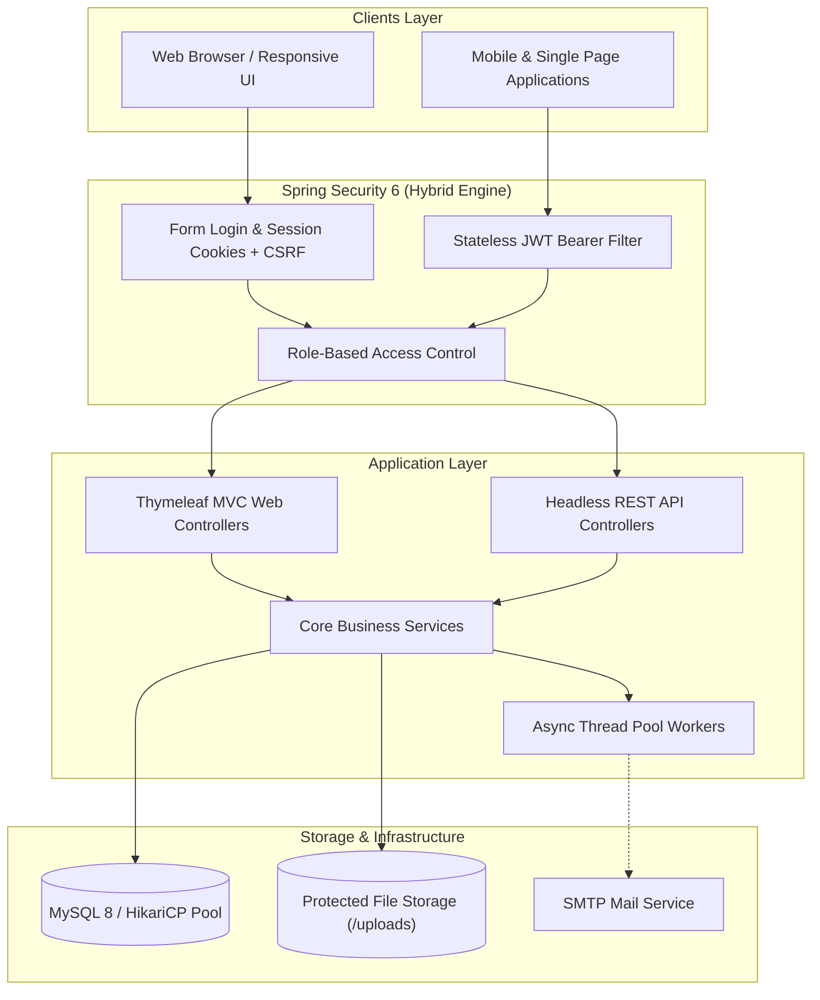

# 💼 CareerLink — Enterprise Full-Stack Job Portal & Recruitment Platform

[](https://www.oracle.com/java/)
[](https://spring.io/projects/spring-boot)
[](https://spring.io/projects/spring-security)
[](https://www.mysql.com/)
[](https://www.docker.com/)
[](http://localhost:8080/swagger-ui/index.html)
[](LICENSE)

> **CareerLink** is a production-grade, enterprise talent acquisition and job recruitment platform. It streamlines the complete hiring workflow between job seekers, corporate recruiters, and administrators with role-based dashboards, asynchronous email notifications, recruitment funnel analytics, and headless REST APIs.

---

## 🌟 Key Capabilities & Features

### 👤 For Candidates
- **Smart Job Search**: Multi-parameter search by keyword, city, job category, and employment type (Full-Time, Remote, Internship) with server-side pagination.
- **1-Click Application**: Apply directly with an optional cover note and attach a custom PDF resume or auto-link the profile resume.
- **Live Status Tracking**: Monitor application progression in real time through 5 stages (`APPLIED`, `SHORTLISTED`, `INTERVIEW_SCHEDULED`, `ACCEPTED`, `REJECTED`).
- **Interview Scheduling**: View scheduled video interview slots with clickable Google Meet / Zoom meeting links.
- **In-App & Email Alerts**: Real-time notification badge on the navigation bar plus automatic HTML confirmation emails.
- **Bookmarks**: Save vacancies for later review.

### 🏢 For Recruiters / HR
- **Vacancy Publishing**: Post new job openings with compensation bands, experience requirements, and skill tags.
- **Applicant Pipeline Review**: Filter applicants per vacancy, review cover notes, and inspect PDF resumes inline directly in the browser.
- **Status State Machine**: Advance candidate status or schedule live interview rounds with date/time and meeting URLs.
- **Hiring Funnel Analytics**: Live conversion metrics dashboard (Total Applicants, Shortlist %, Interview %, Hire %) with drop-off visualization.
- **Data Export**: Export applicant pipelines to RFC 4180-compliant CSV spreadsheets with spreadsheet formula injection protection.

### 🛡️ For Administrators
- **Recruiter Account Verification**: Review and approve/reject corporate recruiter onboarding requests.
- **System Governance**: Oversee vacancies, users, and platform activity.

---

## 🏛️ System Architecture



---

## 💻 Technology Stack

| Layer | Technologies |
| :--- | :--- |
| **Backend Framework** | **Java 21**, **Spring Boot 3.4**, Spring MVC, Spring Data JPA |
| **Security** | **Spring Security 6**, BCrypt Hashing, **JJWT (Java JWT 0.12.x)**, RBAC |
| **Frontend UI** | **Thymeleaf**, **Bootstrap 5**, Bootstrap Icons, Responsive Layouts |
| **Database & Pooling** | **MySQL 8.0** (Production), **H2** (Development), **HikariCP** |
| **API Documentation** | **SpringDoc OpenAPI 3**, **Swagger UI** (`/swagger-ui/index.html`) |
| **Async & Messaging** | Spring `@Async`, `ThreadPoolTaskExecutor`, JavaMailSender |
| **Containerization** | **Docker** (Multi-Stage Alpine JRE 21), **Docker Compose** |

---

## 📡 REST API Reference

CareerLink exposes a headless REST API documented via OpenAPI 3. Access the interactive Swagger UI playground at:  
👉 **`http://localhost:8080/swagger-ui/index.html`**

| Method | Endpoint | Access | Description |
| :--- | :--- | :--- | :--- |
| `POST` | `/api/v1/auth/login` | Public | Authenticates credentials, returns signed JWT Bearer token |
| `POST` | `/api/v1/auth/register` | Public | Registers a new Candidate or Recruiter account |
| `GET` | `/api/v1/jobs` | Public | Paginated, filtered job search (`keyword`, `location`, `categoryId`, `jobType`, `page`, `size`) |
| `GET` | `/api/v1/jobs/{id}` | Public | Retrieves specific job opening details |
| `GET` | `/api/v1/jobs/categories` | Public | Returns all job categories |
| `POST` | `/api/v1/jobs` | `ROLE_HR` | Creates a new job vacancy (Requires Bearer Token) |
| `GET` | `/api/v1/candidate/profile` | `ROLE_CANDIDATE` | Retrieves profile of authenticated candidate |
| `GET` | `/api/v1/candidate/applications` | `ROLE_CANDIDATE` | Lists applications of authenticated candidate |
| `POST` | `/api/v1/candidate/apply` | `ROLE_CANDIDATE` | Submits job application (Requires Bearer Token) |

---

## 🔒 Security & Hardening Highlights

- **Hybrid Security Engine**: Web forms enforce stateful HTTP sessions with CSRF tokens; `/api/**` routes enforce stateless HMAC-SHA256 Bearer JWT tokens with CSRF safely bypassed.
- **Password Security**: BCrypt adaptive salt hashing with work factor 10.
- **Path Traversal Protection**: Uploaded resume filenames are sanitized against directory traversal attacks (`../`), assigned cryptographic UUIDs, and validated against a 5MB size limit.
- **Safe CSV Streaming**: Defends against CSV/Excel formula injection (DDE attacks) by neutralizing formula characters (`=`, `+`, `-`, `@`) with prepended apostrophes.
- **Hardened Docker Container**: Runs under an unprivileged `careerlink` non-root user (UID 1000) on Alpine Linux to prevent container breakout.

---

## 🚀 Quickstart & Setup

### Option 1: Run with Docker Compose (Recommended for Production)
Prerequisites: Docker & Docker Compose

```powershell
# From the repository root:
docker compose up --build -d
```
Docker Compose will launch:
1. **MySQL 8.0** with persistent named volume `careerlink_mysql_data`.
2. **CareerLink Application** running the production profile with HikariCP connection pooling.

To stop the containers:
```powershell
docker compose down
```

---

### Option 2: Run Locally with Maven
Prerequisites: JDK 21+

```powershell
cd demo
.\mvnw.cmd spring-boot:run
```
- **Web Portal**: `http://localhost:8080`
- **Swagger UI**: `http://localhost:8080/swagger-ui/index.html`
- **H2 Console**: `http://localhost:8080/h2-console` (JDBC URL: `jdbc:h2:mem:careerlinkdb`, User: `sa`, Password: *blank*)

---

## 🔑 Seed Test Accounts

The platform automatically seeds the database with initial demo accounts:

| Role | Email | Password | Details |
| :--- | :--- | :--- | :--- |
| **Candidate** | `candidate@test.com` | `candidate123` | Pre-applied for Senior Java Developer with interview scheduled. |
| **HR Recruiter** | `recruiter@techcorp.com` | `hr123` | Verified corporate recruiter for *TechCorp Innovations*. |
| **Administrator** | `admin@careerlink.com` | `admin123` | System administrator with HR approval authority. |

---

## 📖 Technical Architecture Specifications

For detailed engineering deep-dives, database design, and architectural specifications, refer to the [`docs/`](docs/) directory:

- [Database Schema & ER Design Specifications](docs/DAY_01_GUIDE.md)
- [JPA Entity Models & Bidirectional Mapping](docs/DAY_02_GUIDE.md)
- [Spring Data Repository Architecture & Dynamic Queries](docs/DAY_03_GUIDE.md)
- [Service Layer Boundaries & Transaction Management](docs/DAY_04_GUIDE.md)
- [Spring Security 6 Architecture & RBAC](docs/DAY_05_GUIDE.md)
- [Authentication Workflow & Dynamic Role Redirection](docs/DAY_06_GUIDE.md)
- [Thymeleaf Layouts & Component Fragments](docs/DAY_07_GUIDE.md)
- [Role-Based Dashboard Specifications](docs/DAY_08_GUIDE.md)
- [Search Engine & Pagination Implementation](docs/DAY_09_GUIDE.md)
- [Secure File Storage & PDF Streaming Engine](docs/DAY_10_GUIDE.md)
- [Application Lifecycle State Machine & Alerts](docs/DAY_11_GUIDE.md)
- [Asynchronous Notification Architecture & Thread Pool](docs/DAY_12_GUIDE.md)
- [Recruiter Analytics Funnel & Safe CSV Export Engine](docs/DAY_13_GUIDE.md)
- [Headless REST Architecture & JWT Security](docs/DAY_14_GUIDE.md)
- [Production Configuration & Multi-Stage Docker Specifications](docs/DAY_15_GUIDE.md)

---

## 📄 License
This project is licensed under the Apache License 2.0.
